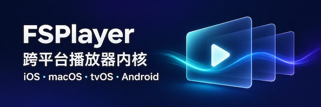

[简体中文](README_zh-CN.md) · **English**

<div align="center">



## FSPlayer

[Apple Integration Guide](doc/getting-started-apple_en-US.md) · [Android Integration Guide](doc/getting-started-android_en-US.md) · [Changelog](CHANGELOG.md) · [Report an Issue](https://github.com/debugly/fsplayer/issues)

[](https://github.com/debugly/fsplayer/releases)


</div>

## Why FSPlayer

FSPlayer builds on [ijkplayer](https://github.com/bilibili/ijkplayer) with native ASS subtitle effects, 4K and HDR playback, and picture-in-picture. Hardware decoding is enabled by default on all supported platforms to reduce stutter and heat. The rendering backends support zero-copy texture uploads when hardware decoding is available.

FSPlayer is open source under the LGPL, actively maintained, and free to use.

## Features

| Feature | Support |
| --- | --- |
| FFmpeg | Based on FFmpeg 8.1.2 with hardware acceleration enabled and ongoing upgrades. |
| iOS | iOS 12 or later. The Xcode 27 configuration requires iOS 15 or later. |
| macOS | macOS 10.14 or later. The Xcode 27 configuration requires macOS 12 or later. |
| tvOS | tvOS 12 or later. The Xcode 27 configuration requires tvOS 15 or later. |
| Android | Android 5.0 (API 21) or later. |
| Rendering backends | Metal on Apple platforms. Android uses Vulkan when available and falls back to OpenGL ES 3. |
| Decoding and rendering | Supports 4K, HDR, AV1, and AVS3. Hardware decoding and HDR output depend on the platform and device. Supports switching between hardware and software decoding, video filters, deinterlacing with software decoding, and transparent video. |
| Subtitles and audio tracks | Supports embedded and external subtitles, including SRT, WebVTT, ASS, and bitmap formats such as PGS. Subtitle styling, subtitle delay, and audio delay are adjustable. |
| Local and network playback | Plays local files, live and on-demand HLS, and streams over HTTP(S), RTSP, RTMP, and SMB. Plays Blu-ray ISO images and BDMV folders over the network. |
| Playback controls | Supports accurate seeking, looping, variable playback speed, and multiple player instances. Reports download speed, buffering progress, and first-frame decode and render timings. |
| Video and output | Supports scaling, rotation, mirroring, brightness and contrast adjustments, frame capture, recording, and real-time PCM output. Some APIs vary by platform. |

[Full feature list](doc/all-feature_en-US.md)

## Quick Start

### Try FSPlayer with Aura

Aura is a sample player built with FSPlayer. It is available for macOS and Android.

- [Download the Android APK](https://github.com/debugly/fsplayer/releases?q=Aura+Android&expanded=true)
- [Download the macOS app](https://github.com/debugly/fsplayer/releases?q=Aura+macOS&expanded=true)
- [Install on macOS with Homebrew](https://github.com/debugly/homebrew-aura)

### Integration Examples

#### Apple (Objective-C)

This example uses macOS.

```objc
#import <FSPlayer/FSPlayer.h>

FSOptions *options = [FSOptions optionsByDefault];
self.player = [[FSPlayer alloc] initWithContent:url options:options];

NSView<FSVideoRenderingProtocol> *playerView = self.player.view;
playerView.frame = self.playerContainer.bounds;
playerView.autoresizingMask = NSViewWidthSizable | NSViewHeightSizable;
[self.playerContainer addSubview:playerView];

self.player.shouldAutoplay = YES;
[self.player prepareToPlay];
```

#### Android (Java)

Once the `SurfaceView` surface is ready, set the media source and prepare the player asynchronously.

```java
FSPlayer player = new FSPlayer();
player.setOption(FSPlayer.OPT_CATEGORY_PLAYER, "mediacodec", 1);
player.setDisplay(surfaceView.getHolder());
player.setDataSource(context, uri);
player.setOnPreparedListener(mp -> mp.start());
player.prepareAsync();
```

- [Full integration guide for iOS, macOS, and tvOS](doc/getting-started-apple_en-US.md)
- [Full integration guide for Android](doc/getting-started-android_en-US.md)

## License

FSPlayer is released under the [LGPL-2.1-or-later](COPYING.LGPLv2.1). Third-party components retain their respective licenses and copyright notices. [Distribution notices](NOTICE)

## FSPlayer-Pro

FSPlayer-Pro is available as a dynamic library. It adds Dolby Vision Profile 5, caching during HLS on-demand playback, seamless switching between audio tracks and quality levels, and faster first-frame startup and seeking for network ISO and BDMV playback. [Contact by email](mailto:debugly@icloud.com)
