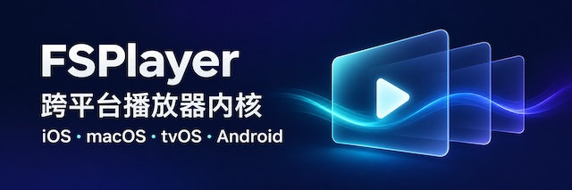

**简体中文** · [English](README.md)

<div align="center">



## FSPlayer

[Apple端使用文档](doc/getting-started-apple.md) · [安卓端使用文档](doc/getting-started-android.md) · [更新日志](CHANGELOG.md) · [反馈问题](https://github.com/debugly/fsplayer/issues)

[](https://github.com/debugly/fsplayer/releases)


</div>

## 为什么选择 FSPlayer

FSPlayer 在 [ijkplayer](https://github.com/bilibili/ijkplayer) 基础上做了大量优化，功能丰富强劲，比如原生支持了ASS特效字幕绘制、4K、HDR、画中画等特性。全平台默认开启硬件加速解码，避免卡顿发热，配合硬解实现零拷贝纹理上传，现代化的渲染后端引擎。

LGPL 协议开源，持续更新，永久免费使用。

## 功能特点

| 功能      | 支持内容                                                                            |
| ------- | ------------------------------------------------------------------------------- |
|  FFmpeg | 基于 FFmpeg 8.1.2，开启硬件加速，后续会持续升级。|
| iOS     | 最低支持 iOS 12 系统，使用 Xcode 27 配置时为 iOS 15 系统     |
| macOS   | 最低支持 macOS 10.14，使用 Xcode 27 配置时为 macOS 12 系统 |
| tvOS    | 最低支持 tvOS 12，系统，使用 Xcode 27 配置时为 tvOS 15 系统 |
| Android | 最低支持 Android 5.0（API 21）|
| 渲染后端 | Apple 平台使用 Metal，Android 优先使用 Vulkan，不可用时回退到 OpenGL ES 3|
| 解码与渲染   | 支持 4K、HDR、AV1 和 AVS3，硬解及 HDR 输出取决于平台和设备。支持软硬解切换、视频滤镜、软解反交错和透明视频。                |
| 字幕与音轨   | 支持内嵌和外挂字幕，包括 SRT、WebVTT、ASS 及 PGS 等图形字幕。可调整字幕样式、字幕延迟和音轨延迟。                      |
| 本地与网络播放 | 支持本地文件、HTTP(S)、HLS 直播与点播，以及 RTSP、RTMP、SMB 等协议。可播放网络上的 Blu-ray ISO 镜像与 BDMV 文件夹。 |
| 播放控制    | 支持精准跳转、循环播放、倍速和多实例播放。可获取下载速度、缓冲进度及首帧解码和渲染耗时。                                    |
| 画面与输出   | 支持缩放、旋转、镜像、亮度和对比度调整，以及截帧、录制和实时 PCM 输出。部分接口因平台而异。                                |

[完整功能列表](doc/all-feature.md)

## 快速开始

### 通过 Aura 体验 FSPlayer

Aura 是基于 FSPlayer 的示例播放器。提供 macOS 和 安卓端安装包，

- [Andorid 端 apk](https://github.com/debugly/fsplayer/releases?q=Aura+Android&expanded=true)
- [macOS 端 app](https://github.com/debugly/fsplayer/releases?q=Aura+macOS&expanded=true)
- [macOS 端通过 brew 安装](https://github.com/debugly/homebrew-aura)

### 接入示例

### Apple（Objective-C）

下面以 macOS 为例：

```objc
#import <FSPlayer/FSPlayer.h>

FSOptions *options = [FSOptions optionsByDefault];
self.player = [[FSPlayer alloc] initWithContent:url options:options];

NSView<FSVideoRenderingProtocol> *playerView = self.player.view;
playerView.frame = self.playerContainer.bounds;
playerView.autoresizingMask = NSViewWidthSizable | NSViewHeightSizable;
[self.playerContainer addSubview:playerView];

self.player.shouldAutoplay = YES;
[self.player prepareToPlay];
```

### Android（Java）

在 `SurfaceView` 的 surface 就绪后，设置播放地址并异步准备：

```java
FSPlayer player = new FSPlayer();
player.setOption(FSPlayer.OPT_CATEGORY_PLAYER, "mediacodec", 1);
player.setDisplay(surfaceView.getHolder());
player.setDataSource(context, uri);
player.setOnPreparedListener(mp -> mp.start());
player.prepareAsync();
```

- [iOS/macOS/tvOS端完整接入文档](doc/getting-started-apple.md)
- [安卓端完整接入文档](doc/getting-started-android.md)

## 开源许可

FSPlayer 使用 [LGPL-2.1-or-later](COPYING.LGPLv2.1) 发布。第三方组件保留各自的许可证和版权声明。 [分发声明](NOTICE)

## FSPlayer-Pro

FSPlayer-Pro 以动态库形式提供 Dolby Vision P5、HLS 点播边播边缓存、无缝切换音轨与清晰度，以及网络 ISO / BDMV 的首帧和跳转加速。 [邮件联系](mailto:debugly@icloud.com)